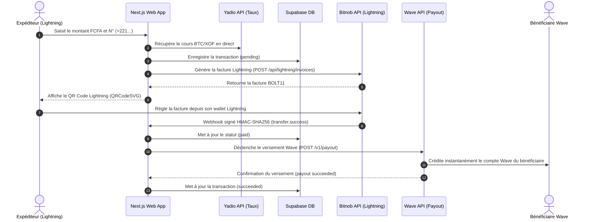
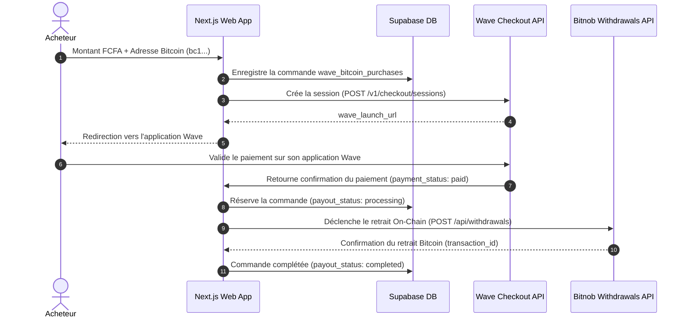

# ⚡ Lightning Bridge (ECO) — Passerelle Bitcoin Lightning & Wave

Passerelle financière bidirectionnelle connectant le réseau **Bitcoin (Lightning Network & On-Chain)** au réseau **Mobile Money Wave (Sénégal - XOF)**.

Le projet permet d'exécuter deux flux complémentaires :
1. **Cash-Out (Lightning → Wave)** : Envoyer des FCFA sur un compte Wave au Sénégal en réglant instantanément via une facture **Bitcoin Lightning (BOLT11)**.
2. **Cash-In (Wave → Bitcoin On-Chain)** : Acheter du Bitcoin directement avec son solde Wave et le recevoir sur son adresse Bitcoin personnelle (`bc1...`).

---

## 📌 Sommaire

1. [Aperçu des Deux Flux Métier](#-aperçu-des-deux-flux-métier)
2. [Architecture & Diagrammes de Flux](#-architecture--diagrammes-de-flux)
3. [Structure Détaillée du Projet](#-structure-détaillée-du-projet)
4. [Intégration de l'API Wave](#-intégration-de-lapi-wave)
5. [Intégration de l'API Bitnob](#-intégration-de-lapi-bitnob)
6. [Conversion & Taux de Change (API Yadio)](#-conversion--taux-de-change-api-yadio)
7. [Base de Données & Tables Supabase](#-base-de-données--tables-supabase)
8. [Variables d'Environnement](#-variables-denvironnement)
9. [Scripts Utilitaires & Tests CLI](#-scripts-utilitaires--tests-cli)
10. [Installation et Démarrage](#-installation-et-démarrage)

---

## 🚀 Aperçu des Deux Flux Métier

### 1. Flux Lightning → Wave (Envoi de FCFA / Remittance)
- **Objectif** : Une personne à l'international (ou disposant de Bitcoins) souhaite transférer de l'argent à un proche au Sénégal sur son compte Wave.
- **Fonctionnement** :
  1. L'expéditeur saisit le montant en FCFA (minimum 100 FCFA) et le numéro Wave du bénéficiaire (+221...).
  2. Le serveur calcule instantanément l'équivalent en Satoshis au taux du marché via **Yadio**.
  3. Une facture Lightning BOLT11 est générée via **Bitnob** et affichée sous forme de QR Code interactif.
  4. Dès que l'expéditeur paie la facture, le Webhook Bitnob notifie notre serveur.
  5. Le serveur déclenche automatiquement le versement des FCFA vers le compte Wave du bénéficiaire via l'**API Wave Payout**.

### 2. Flux Wave → Bitcoin On-Chain (Achat de Bitcoin avec Wave)
- **Objectif** : Un utilisateur local au Sénégal souhaite acheter du Bitcoin avec son compte Wave.
- **Fonctionnement** :
  1. L'utilisateur indique le montant en FCFA et son adresse Bitcoin de réception (`bc1...`, `1...` ou `3...`).
  2. Le serveur crée une session de paiement sécurisée via **Wave Checkout**.
  3. L'utilisateur est redirigé vers l'application mobile Wave (`wave_launch_url`) pour valider son paiement.
  4. Dès confirmation du paiement Wave, le serveur ordonne un retrait Bitcoin on-chain via l'API **Bitnob Withdrawals** vers l'adresse indiquée.

---

## 🔄 Architecture & Diagrammes de Flux

### Flux 1 : Paiement Lightning → Versement Wave (Cash-Out)



### Flux 2 : Achat Bitcoin avec Wave (Cash-In)



---

## 📁 Structure Détaillée du Projet

```text
bitnob-app/
├── app/
│   ├── page.tsx                          # Interface principale : Création Facture Lightning & Payout Wave
│   ├── page.module.css                   # Styles CSS modernes (thème anthracite, responsive)
│   ├── layout.tsx                        # Layout racine Next.js
│   ├── globals.css                       # Styles globaux TailwindCSS
│   │
│   ├── buy-bitcoin/                      # Parcours d'achat de Bitcoin avec Wave
│   │   ├── page.tsx                      # Formulaire montant FCFA, adresse Bitcoin, redirection Wave
│   │   └── confirmation/
│   │       └── page.tsx                  # Confirmation du paiement Wave et statut du transfert BTC
│   │
│   └── api/                              # Routes d'API serveur Next.js
│       ├── invoices/route.ts             # Création transaction + émission facture Lightning Bitnob
│       ├── btc-rate/route.ts             # Taux de change BTC/XOF en direct via Yadio
│       ├── webhooks/bitnob/route.ts      # Webhook Bitnob sécurisé par signature HMAC-SHA256
│       ├── payouts/wave/route.ts         # Déclenchement du versement Wave (API Payout)
│       ├── wave/checkout/route.ts        # Création de session de paiement Wave Checkout
│       ├── wave/status/route.ts          # Consultation du statut d'une commande Wave
│       ├── bitnob/withdrawals/route.ts   # Retrait Bitcoin on-chain via Bitnob
│       └── test/simulate-payment/route.ts# Simulation de paiement Lightning pour l'environnement de test
│
├── lib/                                  # Modules partagés et intégrations tierces
│   ├── wave.ts                           # Client API Wave officiel (Versements Payout /v1/payout)
│   ├── yadio.ts                          # Client Yadio (Conversion FCFA ↔ Satoshis)
│   └── supabase.ts                       # Client Supabase connecté à la base de données
│
├── scripts/                              # Scripts d'administration et tests CLI Node.js
│   ├── check-bitnob-balance.mjs          # Consultation du solde du compte Bitnob (BTC/USD)
│   ├── check-bitnob-env.mjs              # Vérification des variables d'environnement Bitnob
│   ├── test-bitnob.mjs                   # Test unitaire d'émission de facture Lightning Bitnob
│   ├── test-bitnob-webhook.mjs           # Simulation d'un webhook entrant signé HMAC-SHA256
│   └── test-bitnob-withdrawal.mjs        # Test d'initiation d'un retrait Bitcoin on-chain
│
├── next.config.ts                        # Configuration Next.js (Turbopack, optimisations)
├── package.json                          # Dépendances du projet (@supabase/supabase-js, qrcode.react...)
└── .env.local                            # Fichier des clés secrètes et variables d'environnement
```

---

## 🌊 Intégration de l'API Wave

Le module [`lib/wave.ts`](lib/wave.ts) implémente directement l'**API Wave Business officielle** :

### 1. Versement Mobile Money (Payout)
- **URL** : `POST https://api.wave.com/v1/payout`
- **Authentification** : `Authorization: Bearer WAVE_API_KEY`
- **Idempotence** : En-tête `Idempotency-Key: ECO_WAVE_<transactionId>` pour garantir qu'un même versement ne soit jamais exécuté deux fois par inadvertance.
- **Format du Payload** :
  ```json
  {
    "currency": "XOF",
    "receive_amount": "5000",
    "mobile": "+221771234567",
    "client_reference": "uuid-de-la-transaction"
  }
  ```
- **Règles de validation strictes** :
  - La devise doit impérativement être `XOF`.
  - Le numéro de téléphone doit respecter le format international E.164 (`+221...`).
  - Le montant doit être un entier positif strict.

### 2. Encaissement Wave (Checkout Sessions)
- **URL** : `POST https://api.wave.com/v1/checkout/sessions`
- Utilisé dans [`app/api/wave/checkout/route.ts`](app/api/wave/checkout/route.ts) pour générer l'URL de paiement `wave_launch_url` qui ouvre l'application Wave de l'acheteur.

---

## ⚡ Intégration de l'API Bitnob

L'application interagit avec l'API Bitnob (`https://api.bitnob.com`) pour les opérations Bitcoin (Lightning et On-Chain).

### 1. Authentification & Signature Cryptographique HMAC-SHA256
Toutes les requêtes adressées à Bitnob (création de facture, retraits, consultation de solde) sont signées cryptographiquement :
- **En-têtes générés** :
  - `X-Auth-Client` : Identifiant `BITNOB_CLIENT_ID`
  - `X-Auth-Timestamp` : Horodatage Unix en secondes
  - `X-Auth-Nonce` : Valeur aléatoire unique
  - `X-Auth-Signature` : Signature HMAC-SHA256 au format hexadécimal
- **Chaîne canonique signée** :
  ```text
  CLIENT_ID:TIMESTAMP:NONCE:CORPS_DE_LA_REQUETE
  ```

### 2. Endpoints Bitnob Exploités

| Endpoint | Méthode | Rôle | Fichier |
| :--- | :---: | :--- | :--- |
| `/api/lightning/invoices` | `POST` | Émission d'une facture Lightning (BOLT11) | `app/api/invoices/route.ts` |
| `/api/balances/BTC` | `GET` | Consultation du solde disponible en Satoshis | `scripts/check-bitnob-balance.mjs` |
| `/api/withdrawals` | `POST` | Retrait Bitcoin On-Chain vers adresse client | `app/api/bitnob/withdrawals/route.ts` |

### 3. Traitement Sécurisé des Webhooks
Dans [`app/api/webhooks/bitnob/route.ts`](app/api/webhooks/bitnob/route.ts) :
- Vérification de la signature entrante `x-bitnob-signature` avec `crypto.timingSafeEqual` (anti-attaques temporelles).
- Dédoublonnage des événements via la table `bitnob_webhook_events`.
- Validation stricte du montant reçu par rapport au montant initialement attendu.

---

## 💱 Conversion & Taux de Change (API Yadio)

Le module [`lib/yadio.ts`](lib/yadio.ts) gère la conversion entre le Franc CFA (XOF) et le Bitcoin :
- **Endpoint** : `GET https://api.yadio.io/exrates/BTC`
- **Calcul des Satoshis** :
  $$\text{sats} = \left\lfloor \frac{\text{Montant XOF}}{\text{Taux BTC/XOF}} \times 100\,000\,000 \right\rfloor$$
- Sécurité : Vérification que le taux est strictement positif, non nul et fini.

---

## 🗄️ Base de Données & Tables Supabase

L'application repose sur 3 tables principales :

### 1. `transactions` (Flux Lightning → Wave)
- `id` (UUID, clé primaire)
- `amount_xof` (Montant en FCFA à transférer)
- `amount_sats` (Montant équivalent en Satoshis)
- `exchange_rate` (Taux de conversion appliqué)
- `receiver_phone` (Numéro de téléphone Wave du bénéficiaire)
- `receiver_currency` (Devise, fixé à `XOF`)
- `payment_status` (`pending` → `paid` → `failed`)
- `payout_status` (`not_started` → `processing` → `succeeded` → `failed`)
- `bitnob_invoice_id` (Identifiant de facture Bitnob)
- `payment_hash` (Hash de paiement Lightning)

### 2. `wave_bitcoin_purchases` (Flux Wave → Bitcoin On-Chain)
- `id` (UUID, clé primaire)
- `amount_xof` (Montant en FCFA payé par Wave)
- `bitcoin_address` (Adresse Bitcoin on-chain de réception)
- `client_reference` (Référence unique `BTCBUY_<UUID>`)
- `amount_sats` (Quantité de satoshis due)
- `exchange_rate` (Taux figé au moment de la commande)
- `payment_status` (`pending` → `paid` → `checkout_failed`)
- `payout_status` (`not_started` → `processing` → `completed` → `failed`)
- `wave_checkout_id` & `wave_launch_url`
- `bitnob_withdrawal_id` (Identifiant du retrait Bitnob)

### 3. `bitnob_webhook_events` (Audit & Anti-Rejeu)
- `event_id` (Identifiant unique de l'événement Bitnob)
- `event_type` (ex: `transfer.success`)
- `transaction_id` (Référence interne liée)
- `processing_status` (`received` → `processed` / `ignored` / `failed`)

---

## 🔑 Variables d'Environnement

Renseignez ces variables dans votre fichier `.env.local` :

```env
# -----------------------------------------------------------------------------
# Supabase
# -----------------------------------------------------------------------------
NEXT_PUBLIC_SUPABASE_URL=https://votre-projet.supabase.co
NEXT_PUBLIC_SUPABASE_ANON_KEY=votre_cle_anon_publique
SUPABASE_SERVICE_ROLE_KEY=votre_cle_secrete_service_role

# -----------------------------------------------------------------------------
# Bitnob (Lightning & Retraits Bitcoin)
# -----------------------------------------------------------------------------
BITNOB_BASE_URL=https://api.bitnob.com
BITNOB_CLIENT_ID=votre_client_id_bitnob
BITNOB_CLIENT_SECRET=votre_client_secret_bitnob
BITNOB_WEBHOOK_SECRET=votre_secret_webhook_bitnob
BITNOB_WITHDRAWALS_ENABLED=false                    # Passer à true pour activer les retraits réels

# -----------------------------------------------------------------------------
# Wave (Versements Payout & Checkout)
# -----------------------------------------------------------------------------
WAVE_API_KEY=wave_sn_prod_ou_wave_sn_test_xxx       # Clé d'API Wave Business

# -----------------------------------------------------------------------------
# Configuration de l'Application
# -----------------------------------------------------------------------------
APP_BASE_URL=http://localhost:3000
ENABLE_TEST_SIMULATION=true                         # Active les boutons de simulation en dev
```

---

## 🛠️ Scripts Utilitaires & Tests CLI

Le dossier `scripts/` contient des outils Node.js autonomes pour valider l'infrastructure :

```bash
# 1. Vérifier la configuration des variables d'environnement Bitnob
node scripts/check-bitnob-env.mjs

# 2. Consulter le solde du compte Bitnob (BTC et USD)
node scripts/check-bitnob-balance.mjs

# 3. Tester l'émission d'une facture Lightning réelle sur Bitnob
node scripts/test-bitnob.mjs

# 4. Simuler la réception d'un Webhook de paiement Bitnob signé HMAC
node scripts/test-bitnob-webhook.mjs

# 5. Tester l'appel de retrait Bitcoin On-Chain
node scripts/test-bitnob-withdrawal.mjs
```

---

## 💻 Installation et Démarrage

### 1. Installation des dépendances
```bash
pnpm install
```

### 2. Lancement en mode développement
```bash
pnpm dev
```
Ouvrez [http://localhost:3000](http://localhost:3000) dans votre navigateur.

- **Page d'accueil (`/`)** : Flux Lightning → Wave (création de facture, scan QR code, test de versement Wave).
- **Page Achat de Bitcoin (`/buy-bitcoin`)** : Flux Wave → Bitcoin (paiement Wave avec réception de Bitcoins sur son adresse).

### 3. Compilation pour la production
```bash
pnpm build
pnpm start
```
